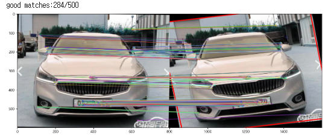
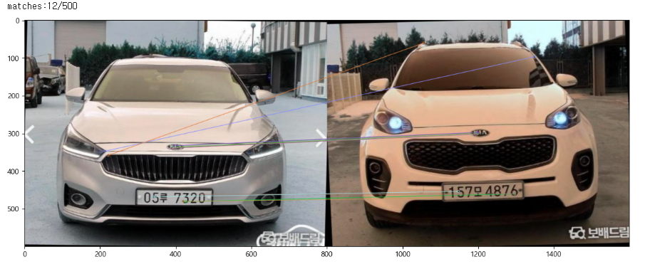
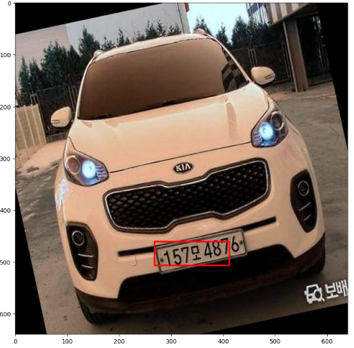

# 복제 번호판 차량 탐지

남의 번호판을 복제해 다른 차에 붙인 차량을 주차장 입구에서 걸러내는 진입 보안 검사 프로그램입니다. 번호판 번호만 확인하는 기존 방식과 달리, 등록된 차량 사진과 실제 진입 차량을 이미지로 한 번 더 비교합니다.

| 등록 차량과 같은 차 (기울어진 사진) | 등록 차량과 다른 차 |
| --- | --- |
|  |  |
| 특징점 284/500개 일치 → 같은 차량으로 판정 | 특징점 12/500개 일치 → 다른 차량으로 판정 |

## 프로젝트 정보

| 항목 | 내용 |
| --- | --- |
| 기간 | 2024.09 ~ 2024.12 (2024년 2학기) |
| 수업 | 한밭대학교 오픈소스 SW 프로그래밍 팀 프로젝트 |
| 팀 | 오전 3조, 5명 |
| 역할 | 객체 탐지·번호판 인식 담당 |

## 문제와 해결

**문제** — 아파트 주차비를 아끼거나 단속을 피하려고, 다른 차의 번호판을 종이 등으로 복제해 붙이는 범죄가 실제로 일어나고 있습니다. 번호판 번호만 읽는 기존 주차 시스템은 번호가 등록되어 있으면 그대로 통과시킵니다.

**해결** — 번호판 번호가 등록되어 있어도, 그 번호로 등록된 차량의 사진과 지금 들어오는 차량이 같은 차인지 이미지로 다시 확인합니다. 네 가지 검사를 모두 통과해야 진입할 수 있습니다.

## 내가 한 일

- **YOLOv5 번호판 탐지 모델 학습**: AI Hub의 자동차 번호판 데이터셋(자동차 차종/연식/번호판 인식용 영상)으로 YOLOv5 모델을 학습하고, 팀이 직접 촬영해 모은 번호판 사진(1인당 낮 50장·밤 50장 이상)으로 검증했습니다. (`best.pt`)
- **진입 시뮬레이션 프로그램 제작**: 팀원들이 각자 만든 번호판 인식, 이미지 매칭, 특징점 매칭 코드를 하나의 진입 검사 흐름으로 묶었습니다. 각 검사 단계는 데코레이터로 감싸 시작·통과·실패가 같은 형식으로 출력되게 했습니다. (`parking_program - 데코레이터를 사용한 보안 검사.ipynb`)
- **테스트 차량 데이터 구성**: 시뮬레이션에 쓸 등록 차량·진입 차량 사진을 준비했습니다. (`test_car/`의 `lightcar`, `whitecar`)



## 팀 구성

각자 올린 노트북과 커밋 기준입니다.

| GitHub | 담당 |
| --- | --- |
| [@yeekrim](https://github.com/yeekrim) (나) | YOLOv5 번호판 탐지 모델 학습, 최종 진입 검사 프로그램 |
| [@dandan-is-dandan](https://github.com/dandan-is-dandan) | 이미지 매칭, 보안 과정 함수화와 우선순위 큐로 가장 비슷한 차량 찾기 |
| [@junseong00](https://github.com/junseong00) | 특징점·디스크립터 검출기 비교, 테스트 차량 매칭점 찾기 |
| [@Beupei](https://github.com/Beupei) | OpenCV 전처리와 OCR로 번호판 문자 읽기 |
| [@20211890Lee](https://github.com/20211890Lee) | 차량 사진에서 번호판 영역 추출 |

## 동작 방식

```
진입 차량 사진 → YOLOv5 번호판 탐지 → Tesseract OCR 번호 인식 → 4단계 보안 검사 → 진입 허용 / 차단
```

| 단계 | 확인하는 것 | 방법 |
| --- | --- | --- |
| 1. 번호판 등록 여부 | 인식한 번호가 등록 차량 목록에 있는가 | OCR 결과와 등록 번호를 부분 일치로 비교 |
| 2. 이미지 매칭 | 등록된 차량 사진과 전체 모습이 비슷한가 | 평균 해시(Average Hash) + 해밍 거리 |
| 3. 특징점 매칭 | 등록된 차량과 세부 특징이 일치하는가 | ORB 특징점 + knnMatch (비율 0.75), 좋은 매칭 70개 초과 시 통과 |
| 4. 내부 존재 여부 | 같은 번호의 차가 이미 주차장 안에 있지 않은가 | 등록 목록의 `내부존재여부` 값 확인 |

실제 실행 결과입니다.

```text
진입한 차량의 번호판: 157모48761
검사 시작: 번호판 등록 여부 확인
통과: 번호판 등록 여부 확인
검사 시작: 이미지 매칭 확인
  ···이미지 매칭량 : 205.078125
  ···동일 차량입니다.
통과: 이미지 매칭 확인
검사 시작: 특징점 매칭 확인
  ···동일 차량입니다.
  ···특징점 매칭량 : 94/500
통과: 특징점 매칭 확인
검사 시작: 내부 존재 여부 확인
통과: 내부 존재 여부 확인
🚘 모든 보안을 통과했습니다. 진입하십시오. 🚘
```

## 노트북 안내

| 파일 | 내용 |
| --- | --- |
| `1. 이미지 특징점 검출기 비교…ipynb` | 특징점 검출기 비교 |
| `2. 특징 디스크립터 검출기 비교 (SIFT, SURF, ORB)…ipynb` | SIFT·SURF·ORB 디스크립터 비교 |
| `3. 올바른 이미지 매칭점 찾기….ipynb` | 매칭점 필터링, 테스트 차량 적용 |
| `4. 보안 과정 함수화(이미지 매칭, ORB_knnMatch).ipynb` | 이미지 매칭·특징점 매칭 함수화, 우선순위 큐로 가장 비슷한 차량 찾기 |
| `numberplate_read - OpenCV 활용 이미지 처리_익명함수.ipynb` | OpenCV 전처리와 OCR로 번호 읽기 |
| `license_plate_extraction.ipynb` | 차량 사진에서 번호판 영역 추출 |
| `parking_program - 데코레이터를 사용한 보안 검사.ipynb` | 위 기능을 묶은 최종 진입 검사 프로그램 |

수업에서 배운 내용을 적용해 노트북마다 지능형 리스트, 제너레이터 표현식, 데코레이터, 익명 함수, 우선순위 큐 같은 파이썬 문법·자료구조를 활용했습니다.

## 실행 방법

1. YOLOv5를 `yolov5/` 폴더에 받습니다. 개발 당시 버전은 `882c35fc`입니다.
   ```bash
   git clone https://github.com/ultralytics/yolov5.git
   cd yolov5 && git checkout 882c35fc && pip install -r requirements.txt
   ```
2. Tesseract OCR과 한국어 학습 데이터를 설치합니다. 코드는 `kornum+kor` 언어 설정을 사용합니다.
3. `parking_program - 데코레이터를 사용한 보안 검사.ipynb`를 열고, 노트북 안의 테스트 이미지 경로를 내 환경에 맞게 바꾼 뒤 위에서부터 실행합니다.

## 한계

- **OCR 오인식**: `157모4876`을 `157모48761`로 읽는 것처럼 OCR 결과가 틀릴 수 있습니다. 그래서 등록 번호와의 비교를 부분 일치로 처리했습니다.
- **테스트 규모**: 레포에 있는 테스트 차량 사진은 10장이고, 매칭 기준값(해시 250, 특징점 70개)은 고정값입니다. 다양한 차량·환경에서 기준값을 검증하지는 못했습니다.
- **인식 실패 상황**: 번호판이 가려지거나 조명이 어두운 경우, 사진에 차량이 여러 대 있는 경우에는 번호판 탐지나 문자 인식이 실패했습니다.
- **노트북 기반**: 경로가 노트북 안에 고정되어 있고, 등록 차량 정보도 코드 안의 표로 대신했습니다.

---

이 레포는 [OpenSource3Team/fake-license-plate-detection](https://github.com/OpenSource3Team/fake-license-plate-detection)의 fork입니다.
